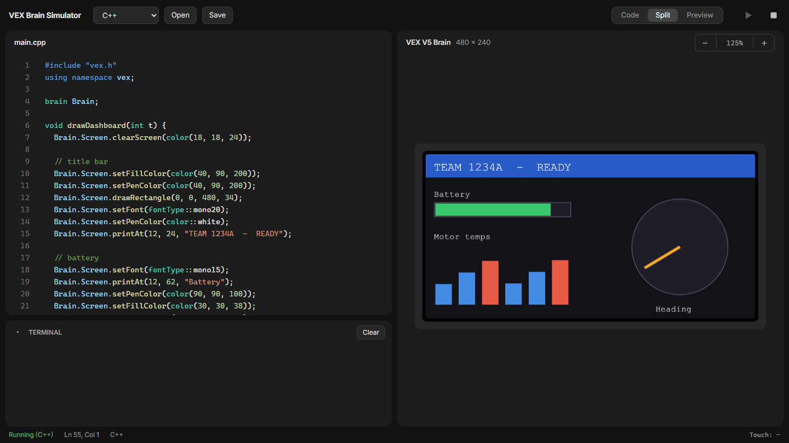
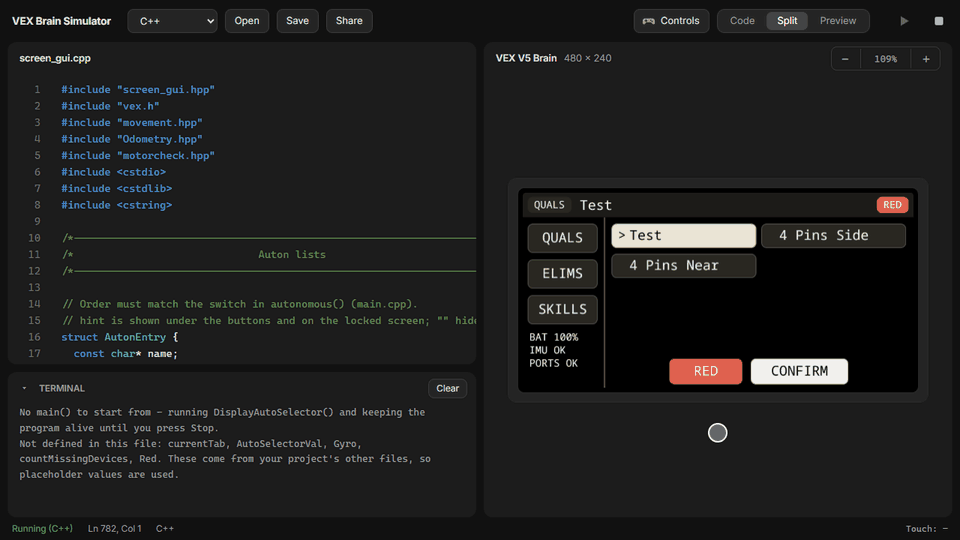
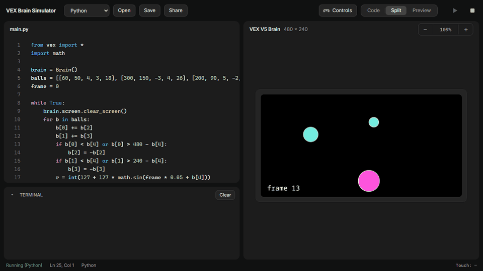
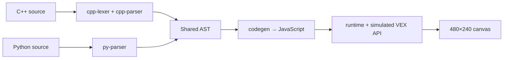

<div align="center">

# VEX Brain Simulator

**See what your VEX V5 Brain screen will look like, without a robot.**

Paste VEXcode **C++** or **Python**, press **Run**, and it draws on a virtual 480×240 Brain touchscreen.
Click the screen to touch it, so auto selectors and menus work too.




</div>

## Features

- **C++ and Python.** Write VEXcode the way you would for the real Brain. The language is detected automatically.
- **Interactive touchscreen.** Clicks become Brain touches, so `pressing()`, `xPosition()` and `pressed()` callbacks work.
- **Real project files.** Open a `.cpp`, `.hpp` or `.py` straight from your robot project, even one without `main()`.
- **Live animation.** `wait()` really waits and `while (true)` loops keep running without freezing the page. **Stop** always works.
- **Competition testing.** Programs that use `Competition` get **Autonomous** and **Driver control** buttons.
- **Web or desktop.** The same code runs in the browser and as an Electron desktop app.

## Demos

### Test an auto selector by tapping it

Open your team's selector file and tap through it as you would on a real Brain. This is
[`tests/fixtures/screen_gui.cpp`](tests/fixtures/screen_gui.cpp). It has no `main()`, so the simulator starts
`DisplayAutoSelector()` itself. Names from headers that weren't loaded are replaced with placeholders.



### Animate in Python

Loops with `wait()` run in real time, so you can preview animations, dashboards and status screens.



<details>
<summary>Show the Python code</summary>

```python
from vex import *
import math

brain = Brain()
balls = [[60, 50, 4, 3, 18], [300, 150, -3, 4, 26], [200, 90, 5, -2, 12]]
frame = 0

while True:
    brain.screen.clear_screen()
    for b in balls:
        b[0] += b[2]
        b[1] += b[3]
        if b[0] < b[4] or b[0] > 480 - b[4]:
            b[2] = -b[2]
        if b[1] < b[4] or b[1] > 240 - b[4]:
            b[3] = -b[3]
        r = int(127 + 127 * math.sin(frame * 0.05 + b[4]))
        g = int(127 + 127 * math.sin(frame * 0.05 + b[4] + 2))
        brain.screen.draw_circle(b[0], b[1], b[4], Color(r, g, 220))
    brain.screen.set_pen_color(Color.WHITE)
    brain.screen.print_at("frame", frame, x=10, y=230)
    frame += 1
    wait(20, MSEC)
```

</details>

## Getting started

You need [Node.js](https://nodejs.org/) 18 or newer.

```bash
git clone https://github.com/BrinHan/Vex-Brain-Simulator.git
cd Vex-Brain-Simulator
npm install
npm run dev
```

Then open <http://localhost:5173>.

| Command           | What it does                                       |
| ----------------- | -------------------------------------------------- |
| `npm run dev`     | Web app with hot reload at `http://localhost:5173` |
| `npm run desktop` | Build, then open the Electron desktop app          |
| `npm run dist`    | Make an installer for your OS (electron-builder)   |
| `npm run build`   | Static site in `dist/` that can be hosted anywhere |
| `npm test`        | Run the engine tests (Vitest)                      |

### Shortcuts

| Keys                | Action                                  |
| ------------------- | --------------------------------------- |
| `Ctrl` + `Enter`    | Run                                     |
| `Ctrl` + `B`        | Switch between Split and Preview layout |
| `Tab` in the editor | Indent                                  |

Use **Code / Split / Preview** in the top bar to choose the layout, and **− / +** to zoom the Brain. Click the zoom
percentage to fit the screen to the window.

## Using real project files

Click **Open** or drop a `.cpp`, `.hpp` or `.py` file onto the editor. Project files usually aren't whole programs, so:

- **No `main()`?** The simulator picks the most likely function to start from, such as `DisplayAutoSelector()`. The
  program then keeps running until you press Stop, so touch handlers and background threads keep working.
- **Missing names** from headers you didn't load (`Gyro`, `Controller1`, `currentTab`, `monoS` and so on) become
  placeholder values. They are listed once in the Terminal, so real typos still stand out.
  `monoS` / `monoM` are treated as mono15 / mono20.
- **Supported C++ beyond the basics:** `#define` macros, `static` locals, `char` buffers with `snprintf`/`strlen`,
  `operator==`-style overloads, `enum`, structs/classes with constructors, `vex::thread` and `vex::mutex`.

## Supported VEX API

<details open>
<summary><b>Brain.Screen</b> (C++ camelCase and Python snake_case)</summary>

`clearScreen`, `clearLine`/`clear_row`, `setCursor`, `row`, `column`, `newLine`/`next_row`, `setPenColor`,
`setFillColor`, `setPenWidth`, `setFont`, `setOrigin`, `drawPixel`, `drawLine`, `drawRectangle`, `drawCircle`,
`print`, `printAt`/`print_at` (printf-style in C++; `sep`/`precision`/`x`/`y`/`opaque` keywords in Python),
`getStringWidth`, `pressing`, `xPosition`, `yPosition`, `pressed`, `released`, `render`.

</details>

<details>
<summary><b>Everything else</b></summary>

- `color` / `Color`: constants, RGB, hex and HSV
- `fontType` / `FontType`
- `wait`, `waitUntil`, `thread`/`Thread`, `task`
- `Brain.Timer`, `Brain.Battery`
- `Competition` callbacks (buttons appear above the screen)
- `printf`, `std::cout` and Python `print` (shown in the Terminal)

Motors, sensors, the controller and other devices are accepted and ignored, so real programs still run.

</details>

## How it works

Your code doesn't go through a real compiler. A C++ or Python front end parses it into one shared syntax tree,
which is translated to JavaScript and run against a simulated VEX API.



Every call is awaited, so `wait()` really waits, infinite loops don't freeze the page, and **Stop** always works.

```
src/lang/   cpp-lexer, cpp-parser, py-parser → ast → codegen → JS
src/sim/    screen (Brain.Screen), env (VEX globals), helpers (C++/Python semantics), runtime (run/stop/tasks)
src/        main.ts (UI), examples.ts, highlight.ts
electron/   desktop app entry point
tests/      engine tests and real-world fixtures
```

## Known limits

- **C++:** no templates, user-defined operator overloading, pointers/`new`, or references to primitives (`int&`).
  It's a practical subset aimed at screen and UI code.
- **Python:** no nested comprehensions, `match`, or generators.
- `printAt(x, y)` treats `y` as the text baseline. If it doesn't match a real Brain, adjust `ASCENT` in
  `src/sim/screen.ts`. The default font is mono20 (10×20 px, 12 rows × 48 columns).
- Text uses a browser font, so letter shapes differ from the Brain's. Sizes and positions match.
- Python floats and ints are both JavaScript numbers, so `print(5.0)` shows `5`.
- Runtime errors show the message but not a line number. Syntax errors show both.
